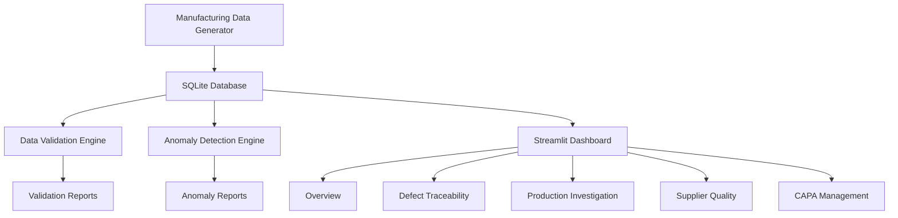

# TraceForge AI — System Architecture

## 1. Architecture Overview

TraceForge AI uses a Python-based manufacturing traceability architecture.

## 2. Data Flow

1. The generator creates synthetic manufacturing records.
2. Records are stored in a relational SQLite database.
3. The validation engine checks data integrity and manufacturing relationships.
4. The anomaly detector evaluates deliberately constructed anomaly fixtures.
5. The Streamlit dashboard provides interactive investigation and reporting.

## 3. Core Traceability Relationships

A defect can be investigated through the following chain:

**Inspection Result → Production Order → Process Step → Machine**

and

**Inspection Result → Defect → Material Lot → Supplier**

Corrective actions are associated with defects and tracked through their lifecycle.

## 4. Technology

- Python: application and processing logic
- SQLite: relational persistence
- Pandas: data analysis
- Streamlit: interactive dashboard
- Plotly: visualizations
- Pytest: automated testing

## 5. Current Scope

This is a working prototype using reproducible synthetic manufacturing data. Anomaly detection currently uses rule-based checks rather than a trained machine learning model.